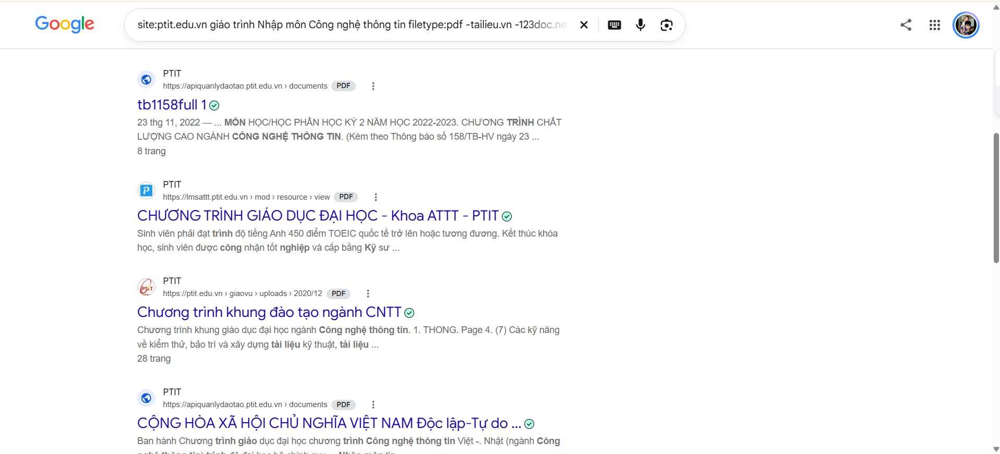

#  Tìm kiếm tài liệu học tập chính thống bằng Google

Để tìm được tài liệu chuẩn mà không dính các trang web rác thì chúng ta cần nhập trên thanh tìm kiếm như sau:  

- site:ptit.edu.vn "giáo trình Nhập môn Công nghệ thông tin" filetype:pdf -tailieu.vn -123doc.net

***Tại sao dùng toán tử filetype: lại tiết kiệm thời gian hơn gõ "tải sách..." thông thường?***

Bình thường nếu gõ mấy câu chung chung kiểu "tải giáo trình nhập môn công nghệ thông tin" hoặc "download sách nhập môn cntt miễn phí", Google sẽ quét và ưu tiên hiển thị hàng loạt trang web SEO bẩn, blog reup tài liệu cũ, hoặc các kho lưu trữ trung gian. Kết quả là khi click vào, bạn sẽ bị ép xem quảng cáo dày đặc, bắt đăng nhập tài khoản, nạp thẻ cào, hoặc cay đắng hơn là tải phải file giả mạo (định dạng .exe hoặc file nén dính mã độc, adware).

***Khi chúng ta kết hợp toán tử:***

- ***site:ptit.edu.vn:*** Giới hạn phạm vi tìm kiếm chỉ trên máy chủ chính thức của Học viện.

- ***"...":*** Buộc Google phải quét chính xác cụm từ khóa khóa học, tránh bị lệch sang các môn khác.

- ***filetype:pdf:*** Lọc sạch mọi định dạng rác, chỉ trả về các tệp có đuôi .pdf thực sự.

- ***tailieu.vn -123doc.net:*** Loại bỏ thẳng tay các trang web rác hay xuất hiện nhất.

Cách này giúp chúng ta dễ dàng tìm kiếm đúng tài liệu mà mình muốn hơn là tìm tên rồi ngồi kiếm từng trang 

***Kết quả sau khi sử dụng toán tử***

